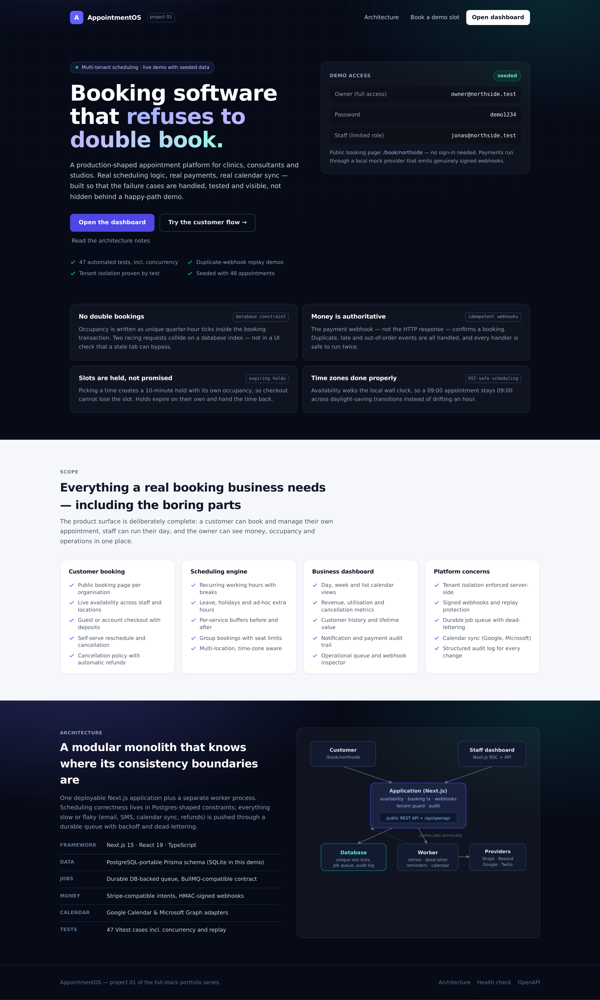
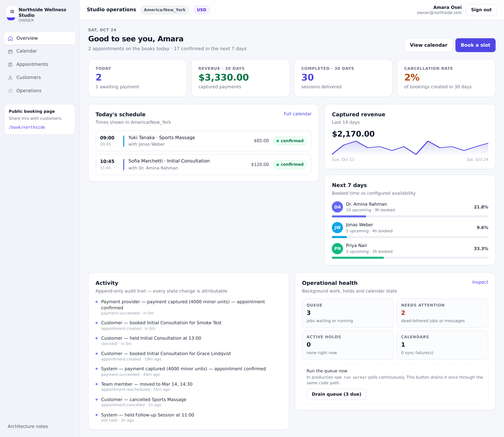
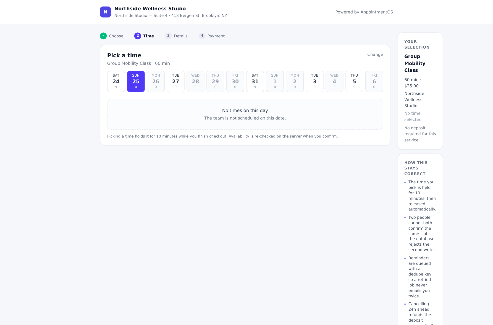
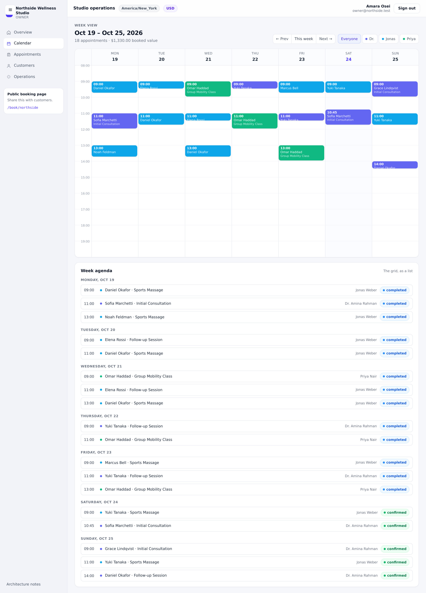
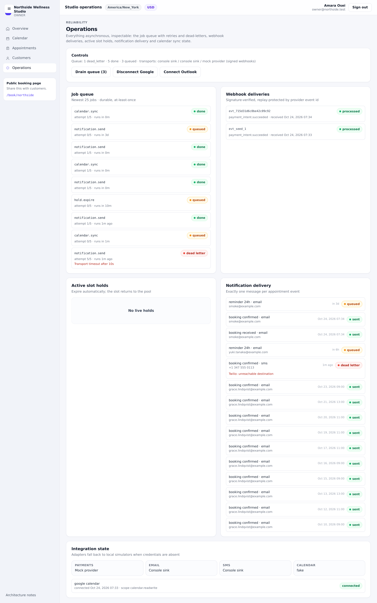

<div align="center">

# AppointmentOS

### Booking software that refuses to double-book.

**A multi-tenant appointment booking and staff scheduling platform.**

[Quick start](#quick-start) · [Screenshots](#screenshots) · [Architecture](#architecture) · [Demo walkthrough](#what-to-try-first)


</div>

<p align="center">
  
</p>

<p align="center"><em>A complete booking platform demo — customer checkout, staff scheduling, payments, and operational visibility.</em></p>

---

Clinics, consultants, studios and repair shops all live or die on the same
problem: two people must never end up in the same chair at the same time, and
money must never confirm a booking that the calendar did not actually hold.

AppointmentOS is a complete, runnable implementation of that problem — customer
booking, a real scheduling engine, deposits and refunds, calendar sync, durable
notifications, tenant isolation and an audit trail. It is built so the failure
cases are first-class: concurrency, duplicate webhooks, expired holds, worker
crashes and stale events are handled, tested, and demonstrable in about two
minutes.

> **Project 01** of a three-part full-stack portfolio series
> (AppointmentOS → FlowForge → LedgerLoop).

---

## Quick start

```bash
npm install
cp .env.example .env          # works as-is; no external accounts needed
npm run db:push               # create the local schema
npm run db:seed               # ~48 appointments of realistic demo data
npm run dev                   # http://localhost:3000
```

Open **http://localhost:3000** for the landing page, or go straight to:

| Surface | URL | Credentials |
| --- | --- | --- |
| Staff dashboard | `/dashboard` | `owner@northside.test` / `demo1234` |
| Limited role (403 demo) | `/dashboard` | `jonas@northside.test` / `demo1234` |
| Second tenant | `/dashboard` | `barber@riverside.test` / `demo1234` |
| Customer booking | `/book/northside` | none needed |

Run the background worker in a second terminal:

```bash
npm run worker          # continuous polling
npm run worker:once     # drain whatever is due, then exit
```

> If you reset the database (`npm run db:reset`) while `npm run dev` is running,
> restart the dev server — SQLite holds a handle to the file that was replaced.

---

## What to try first

1. **Book something.** `/book/northside` → pick a service → pick a time → fill in
   details → pay with the simulated card. You will land on a signed manage link.
2. **Replay the webhook.** On the confirmation screen press *Re-deliver the same
   webhook*. The outcome is `duplicate`: no second charge, no second email, no
   second audit entry.
3. **Break a payment.** Choose *Simulate a declined card*. The booking stays
   `PENDING_PAYMENT`; when the hold expires the slot returns to the pool on its
   own.
4. **Race two customers.** Run the hold request below twice at the same time —
   one gets `201`, the other `409`.
5. **Move and cancel.** In the dashboard open an appointment → *Reschedule* to a
   free slot, then *Cancel*. Watch the audit trail, the refund row and the freed
   calendar slot.
6. **Look at operations.** `/dashboard/operations` shows the job queue
   (including a deliberately dead-lettered job), webhook deliveries, active
   holds, notification delivery and calendar sync state. Press *Drain queue* to
   execute the pending work through the real worker code path.

---

## The five invariants

Everything in the codebase exists to keep these true:

| # | Invariant | Where it is enforced |
| --- | --- | --- |
| 1 | No two live appointments overlap for one staff member | Unique index on `(staffId, tickAt)` in `SlotLock`, written inside the booking transaction |
| 2 | A booking is confirmed by the provider, not by the HTTP response | `src/server/webhooks.ts` |
| 3 | At most one notification and one audit row per event | Unique `Notification.dedupeKey` |
| 4 | No cross-tenant read or write, even with a known id | `requireMembership()` + `orgId` in every query |
| 5 | Local wall-clock intent survives DST, stored as UTC instants | `src/lib/time.ts`, `src/server/availability.ts` |

Each of these has a failing-then-fixed story and a test (see
`tests/booking.test.ts`, `tests/webhooks.test.ts`, `tests/tenancy.test.ts`).

### How the double-booking guard actually works

A booking occupies every 15-minute tick between its **block start**
(`starts – bufferBefore`) and **block end** (`ends + bufferAfter`):

```
09:00–10:00 consult, 15-min buffer after   →  ticks 09:00 09:15 09:30 09:45 10:00 10:15
SlotLock(staffId, tickAt) is UNIQUE        →  any overlapping request collides
```

Two requests that start at different times (09:00 vs 09:30) still collide on
shared ticks. The database decides the winner; the loser gets a friendly `409`
and the availability grid refreshes. Availability itself is re-computed *inside*
the transaction, because a grid rendered four minutes ago is not evidence that a
slot is still free.

On Postgres the same invariant is a `tstzrange` exclusion constraint (see
`docs/adr/0002`).

---

## Architecture

```
Customer (/book/:slug) ──┐
                         ├─► Next.js app (RSC + REST) ──► Postgres-portable DB
Staff (/dashboard)   ────┘        │   availability, booking tx,          │
                                  │   tenant guard, webhooks, audit      │
                                  ▼                                      ▼
                          Worker process  ◄──── durable job table (claim, backoff,
                          email · SMS ·          stale-lock recovery, dead-letter)
                          calendar · refunds
                                  │
                                  ▼
                  Stripe · Resend · Twilio · Google Calendar · Microsoft Graph
```

**Layers**

- `src/lib` — pure primitives: money as integer minor units, timezone/DST
  helpers, typed errors, Prisma client.
- `src/server` — the domain: availability engine, booking lifecycle, webhooks,
  notification rendering/delivery, audit, queries, jobs, integrations.
- `src/app/api` — thin HTTP layer. Validation, authorisation, status codes.
- `src/app` — pages. Server components read via `src/server/queries.ts`.
- `src/worker` — the queue consumer, runnable as its own process.

**Stack:** Next.js 15 (App Router) · React 19 · TypeScript (strict) · Prisma ·
Luxon · Zod · Tailwind CSS 4 · Vitest.

---

## Demo scripts

```bash
# 1 — two customers racing for one slot (run twice, concurrently)
curl -s -X POST localhost:3000/api/public/holds \
  -H 'content-type: application/json' \
  -d '{"orgSlug":"northside","serviceId":"<svc>","staffId":"<staff>","startsAt":"<iso>"}'

# 2 — unsigned webhook is rejected
curl -s -o /dev/null -w '%{http_code}\n' -X POST localhost:3000/api/webhooks/payments \
  -H 'content-type: application/json' \
  -d '{"id":"evt_forged","type":"payment_intent.succeeded"}'
# → 401

# 3 — replay a processed event id
curl -s -X POST localhost:3000/api/public/payments/confirm \
  -H 'content-type: application/json' \
  -d '{"providerRef":"pi_mock_...","eventId":"evt_already_seen"}'
# → {"outcome":{"status":"duplicate"}}

# 4 — health and queue depth
curl -s localhost:3000/api/health
```

A full scripted walkthrough of hold → book → pay → replay → drain lives in
`scripts/smoke.sh`.

---

## Screenshots

| Dashboard | Customer booking |
|:---:|:---:|
|  |  |
| **At-a-glance business health** — today's schedule, revenue, utilisation, and queue | **Live availability** — customers choose a service and a genuinely available time |

| Calendar | Operations |
|:---:|:---:|
|  |  |
| **Overlap-aware scheduling** — a clear view of the team's week | **Built for failure cases** — queue, webhooks, holds, and delivery state |

All screenshots are captured from the seeded demo (`docs/screenshots/`).

---

## Tests

```bash
npm test          # 47 Vitest cases
npm run typecheck # strict TypeScript, no emit
```

The suite builds a throwaway SQLite database (`prisma/test.db`) so it never
touches demo data.

| File | Covers |
| --- | --- |
| `tests/booking.test.ts` | availability windows, buffers, leave/extra hours, **concurrent double-booking**, holds and expiry, idempotency, cancellation policy, reschedule safety, audit |
| `tests/webhooks.test.ts` | signature verification, replay, late/out-of-order events, deferred processing, exactly-one email |
| `tests/tenancy.test.ts` | cross-tenant read/list/cancel/book attempts, scoped dashboards |
| `tests/primitives.test.ts` | money rounding, DST gaps and overlaps, weekdays, window merging, backoff, refund maths |

Notable cases:

- three simultaneous `createBooking()` calls for one slot → exactly one succeeds,
  two get `409`;
- a `payment_intent.payment_failed` arriving after `payment_intent.succeeded` is
  ignored and the payment stays `SUCCEEDED`;
- the same event delivered three times leaves `amountPaidCents` unchanged and one
  `BOOKING_CONFIRMED` notification;
- rescheduling onto an occupied slot throws **and** the original appointment is
  still holding its original ticks.

---

## Configuration

Everything is optional. With an empty `.env` the app runs fully on local
simulators — the mock payment provider still emits genuinely signed webhooks.

| Variable | Default | Purpose |
| --- | --- | --- |
| `DATABASE_URL` | `file:./dev.db?connection_limit=1` | Prisma connection |
| `SESSION_SECRET` | dev value | JWT signing + HMAC for links and webhooks |
| `APP_URL` | `http://localhost:3000` | Used in email links |
| `STRIPE_SECRET_KEY` / `STRIPE_WEBHOOK_SECRET` | empty | Enables the real Stripe path |
| `MOCK_WEBHOOK_SECRET` | `whsec_mock_dev_secret` | Signs mock provider events |
| `NOTIFY_TRANSPORT` | `console` | `console` \| `resend` \| `twilio` |
| `RESEND_API_KEY`, `TWILIO_*` | empty | Live email/SMS |
| `CALENDAR_PROVIDER` | `fake` | `fake` \| `google` \| `microsoft` |
| `GOOGLE_CLIENT_ID`/`SECRET`, `MS_CLIENT_ID`/`SECRET` | empty | Live calendar OAuth |

`/api/health` reports which integrations are live.

---

## Data model

`prisma/schema.prisma` — 24 models. The ones that carry the weight:

| Model | Role |
| --- | --- |
| `Organization`, `Membership`, `User` | tenancy and roles (`OWNER` / `ADMIN` / `STAFF`) |
| `Location`, `Staff`, `Service`, `StaffService` | who can do what, where, in which zone |
| `WorkingHours`, `ScheduleException` | recurring availability plus leave/holiday/extra hours |
| `SlotHold` | expiring provisional reservation (owns ticks) |
| `SlotLock` | **the double-booking guard** — one unique row per 15-minute tick |
| `Appointment` | UTC instants **and** preserved local date/minutes/timezone |
| `Payment`, `Refund` | integer minor units, provider refs, idempotency keys |
| `Notification` | rendered message + `dedupeKey` + attempt/dead-letter state |
| `WebhookEvent` | unique `(provider, externalId)` for replay protection |
| `Job` | durable queue: attempts, `runAt`, lock token, dead-letter |
| `AuditLog` | append-only, actor + before/after metadata |

---

## Project layout

```
appointmentos/
├── prisma/
│   ├── schema.prisma          # 24 models, Postgres-portable
│   └── seed.ts                # deterministic demo data (48 appointments, 2 tenants)
├── src/
│   ├── lib/                   # money, time/DST, errors, db, domain vocabulary
│   ├── server/
│   │   ├── availability.ts    # slot engine (pure-ish, used by grid + booking tx)
│   │   ├── booking.ts         # hold → book → cancel → reschedule → refund
│   │   ├── webhooks.ts        # signed, idempotent, ordered-event handling
│   │   ├── notifications.ts   # templating, dedupe keys, delivery
│   │   ├── jobs.ts            # durable queue (BullMQ-shaped)
│   │   ├── auth.ts            # sessions, requireMembership, requireManager
│   │   ├── queries.ts         # org-scoped read models
│   │   └── integrations/      # payments, email, sms, calendar adapters
│   ├── app/                   # landing, docs, login, dashboard, booking, API
│   └── worker/                # queue consumer process
├── tests/                     # 47 Vitest cases
├── docs/
│   ├── adr/                   # four architecture decision records
│   ├── ERD.md                 # entity relationships and invariants
│   └── screenshots/           # captured UI
├── scripts/smoke.sh           # end-to-end API walkthrough
└── .github/workflows/ci.yml   # typecheck, tests, build
```

---

## Reliability notes

- **Jobs are at-least-once**, so every handler is idempotent by construction:
  notifications use a unique dedupe key, calendar events use a deterministic
  provider id per appointment, refunds are keyed on the refund row.
- **Crashed worker recovery:** a `RUNNING` job whose lock is older than two
  minutes is returned to `QUEUED` and re-claimed.
- **Poison messages** stop after `maxAttempts` and become `DEAD_LETTER` with
  `lastError` intact — visible in the operations page instead of vanishing.
- **Reminder suppression:** a reminder job checks whether the appointment was
  cancelled after the reminder was scheduled, and suppresses itself.
- **Rate limits** on the public surface: 8 holds/min, 10 bookings/min, 10 login
  attempts per 5 min per address.
- **No secrets in the repo.** `.env` is ignored; `.env.example` contains only
  placeholders; tokens are never returned by any API, including to their owner.

---

## Limitations

Stated plainly, because a portfolio project is judged by what it admits:

- **SQLite in this demo.** The schema is Postgres-portable and the migration
  delta (exclusion constraint, `SERIALIZABLE` transactions, real enums) is in
  `docs/adr/0002`. SQLite serialises writers, so sustained write load is not
  representative.
- **Payments are simulated by default.** The mock emits real signed webhooks so
  every code path is exercised, but the Stripe branch is untested without keys.
- **Calendar OAuth is stubbed locally.** The Google/Microsoft adapters are real
  HTTP calls gated by env; the local simulator implements the same interface.
- **Rate limiting is per-process.** Fine for a single instance; multi-instance
  needs a shared counter (Redis `INCR`).
- **No recurring appointments or waitlist auto-promotion** — waitlist candidates
  are surfaced for manual outreach, deliberately.
- **No i18n**; copy and date formats are English/US.

---

## Documentation

- `docs/adr/0001-modular-monolith.md`
- `docs/adr/0002-double-booking-guard.md`
- `docs/adr/0003-durable-job-queue.md`
- `docs/adr/0004-timezones-and-dst.md`
- `docs/ERD.md`
- In-app: `/docs` (architecture notes) and `/api/openapi` (OpenAPI 3.1)

---

Built by **Waleed Muneeb** as project 01 of the full-stack portfolio series.
